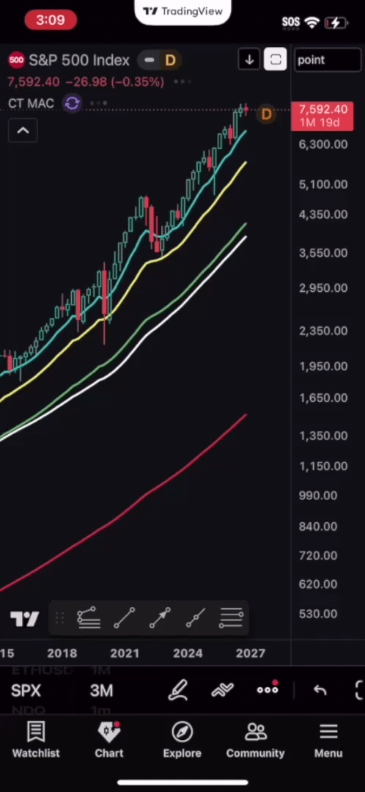
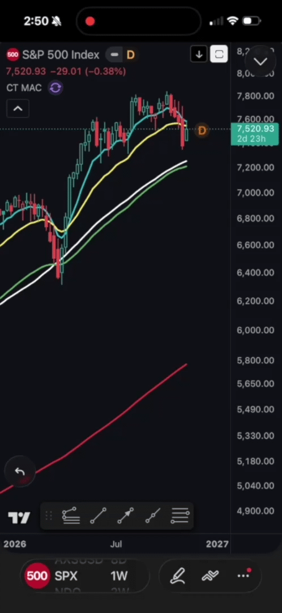
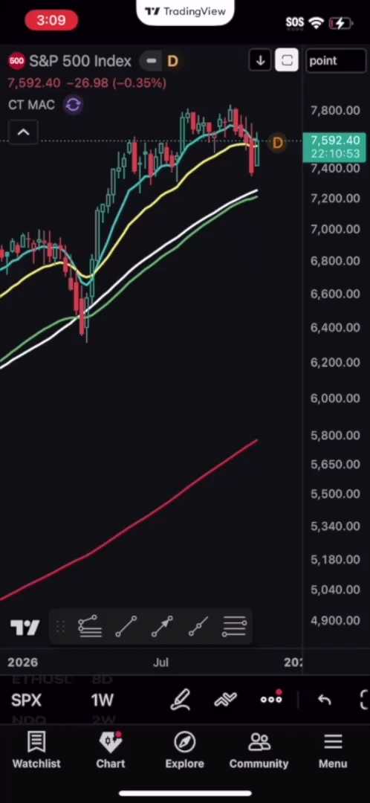
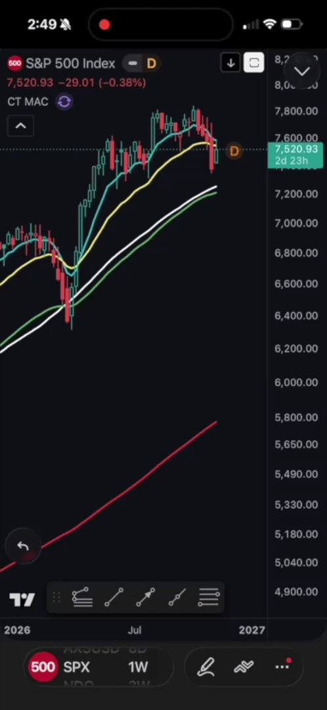
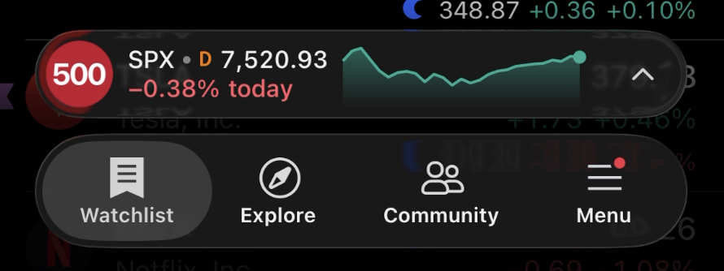

# Checking Stock Charts in TradingView

I use TradingView on my phone to check certain stock prices when I am away from my computer. I usually choose a stock from my watchlist, look at its chart in a few different time frames, then go back to the watchlist and choose another.

After a recent update, I did not notice anything different until I tried to change the chart's time frame. I normally change it by sliding up or down across the time frame shown at the bottom of the chart.

I slid down across it as usual. Instead of just changing the time frame, the whole TradingView screen dropped halfway down my phone. I thought the app had broken.

  <figure style="flex: 1; margin: 0;">
    
    <figcaption style="margin-top: 0.4rem; text-align: center; font-size: 0.9em;">Old layout: the time frame changes</figcaption>
  </figure>
  <figure style="flex: 1; margin: 0;">
    
    <figcaption style="margin-top: 0.4rem; text-align: center; font-size: 0.9em;">New layout: the screen drops</figcaption>
  </figure>

It took me a second to understand what was happening. Sliding down on the time frame control was triggering Reachability, an iPhone feature I had almost forgotten about because I never use it intentionally. The same downward gesture was now changing the chart’s time frame and pulling down the screen, giving the control poor **mapping** because one action produced two unrelated results. 

I could still change the time frame, so the gesture was technically **effective**. But before the update, it was an **efficient** shortcut and sliding through the time frames felt **satisfying**. Now every downward slide pulled down the screen too, making a gesture I used all the time practically unusable. 

Unfortunately, the confusion continued as I tried to go back to my watchlist. My thumb went to the lower-left corner, but there was nothing there. I had not noticed that the navigation bar was gone until I needed it, and now I was not sure how to get to my watchlist. It took me a few seconds to find the small chevron button in the upper-right corner, and I had to shift my grip to reach it. When I tapped it, the chart collapsed and revealed my watchlist underneath.

  <figure style="flex: 1; margin: 0;">
    
    <figcaption style="margin-top: 0.4rem; text-align: center; font-size: 0.9em;">Old layout: tapping Watchlist</figcaption>
  </figure>
  <figure style="flex: 1; margin: 0;">
    
    <figcaption style="margin-top: 0.4rem; text-align: center; font-size: 0.9em;">New layout: collapsing the chart</figcaption>
  </figure>

The chevron button has a clear **affordance**: it looks like it will collapse the chart, and that is what it does. What I did not understand was that the watchlist was behind the chart.

The old layout had separate buttons for the chart and watchlist, so I thought of them as separate pages. That was my **mental model**, or how I thought the app was organized. The new layout uses a different **conceptual model**: the chart is a panel on top of the watchlist. This change was not clear to me until I used the chevron button for the first time.

In the end, I was able to look at a chart in a few time frames and return to my watchlist, but the update turned what used to be a fairly seamless routine into a frustrating one. Changing the time frame on a chart was now partly broken. When I tried to leave the chart, I could not figure out how until I found the chevron button at the top of the screen. I had to change my grip to reach it, and without the navigation bar, I could not go anywhere else directly from the chart view.

At the very least, TradingView needs to fix the time frame gesture so sliding down no longer triggers Reachability. If TradingView wants to keep the new floating controls and collapsible chart, one way to move the time frame control higher would be to build on the layout already used on the new watchlist page. That page has a floating navigation pill at the bottom and a smaller chart pill directly above it.

When the chart expands, the upper pill could transform to show the time frame control and drawing tools while the navigation pill remains visible below it.

This would sacrifice some vertical chart space. However, the current design gained very little by hiding the navigation controls, so I think keeping them visible and within reach would be worth the tradeoff. If preserving that space is nonnegotiable, TradingView could instead let the pills float over the chart itself, just as they float over the watchlist. That would preserve the chart space while eliminating the awkward gray area beneath the chart where the pills currently sit.

Personally, I would still prefer to drop the floating pill style and return to the old layout. Chart and Watchlist were separate pages with their own buttons in a navigation bar that remained visible at the bottom of the screen. That made switching between charts easier, kept the controls within reach, and made the layout look more cohesive overall.
